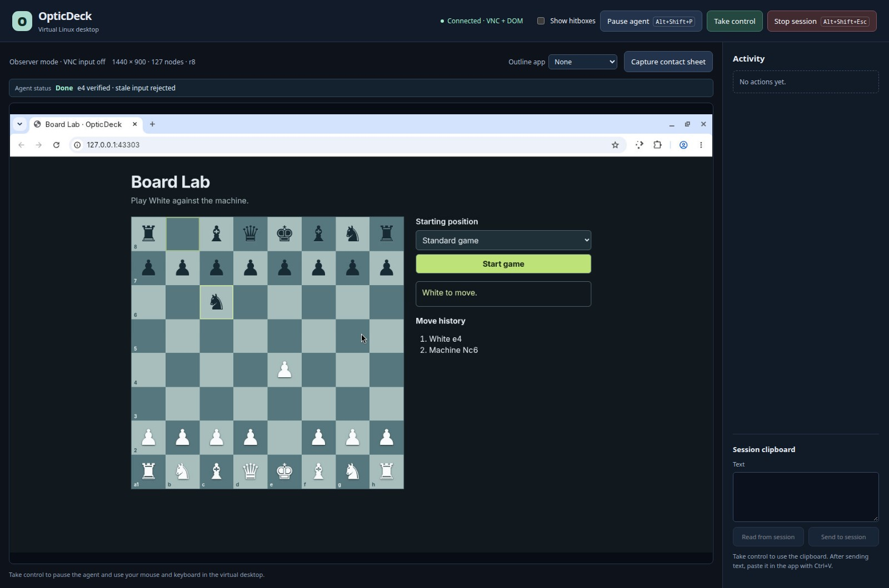

# OpticDeck

[](https://github.com/calinrus-dev/opticdeck/actions/workflows/ci.yml)

Previously published as SemaDesk. The `semadesk` command remains an alias.

OpticDeck runs a separate Linux desktop and exposes native app controls as HTML
and ARIA over a live noVNC view. An agent can find a button by name, fill a
field, or inspect a checkbox through the browser or CLI. When an app exposes
too little accessibility information, OpticDeck marks the region for visual
inspection.

The session has its own virtual X11 display, D-Bus session bus, and window
manager. It keeps running in the background when the browser closes, and its
keyboard and pointer input stay in the virtual desktop.



## Install and run

Build on Linux with Go 1.25 or newer and Make. At runtime, OpticDeck needs
TigerVNC with Unix RFB socket support (`-rfbunixpath`, `-rfbunixmode`, and
`-rfbport -1`), Openbox, D-Bus, and AT-SPI2. The desktop launcher uses
`xdg-open` from `xdg-utils`. The dependency installer selects packages for
Debian and Ubuntu, Arch-based distributions, or Fedora and may ask for
administrator privileges.

```sh
git clone https://github.com/calinrus-dev/opticdeck.git
cd opticdeck
./scripts/install-deps.sh
make install
```

The default install puts the CLI in `~/.local/bin` and adds a **OpticDeck**
launcher to the desktop application menu. Add `~/.local/bin` to your
`PATH` if your shell does not already include it. To try the build directly
from the checkout, run `make build` and use `./bin/opticdeck`.

Open **OpticDeck** from the application menu or run `opticdeck open` to start or reuse
the default session and open its viewer. For a manual start with a printed
URL, use the following commands.

```sh
opticdeck start
opticdeck launch -- zenity --entry --title 'OpticDeck demo' --text 'Your name'
opticdeck tree
```

Install your distribution's `zenity` package for this demo, or replace
`zenity` with another installed app. Open the local URL returned by `start`
in a browser on the same computer. The URL includes a session token. Keep it
out of screenshots, issue reports, and shared logs.

```sh
opticdeck status
opticdeck stop
```

Use the same `--state-dir` with each command to keep multiple sessions.
OpticDeck assigns a free X11 display and, by default, a free HTTP port.

```sh
session_dir=$(mktemp -d)
opticdeck start --state-dir "$session_dir" --width 1280 --height 800 --port 0
opticdeck launch --state-dir "$session_dir" -- xterm
opticdeck stop --state-dir "$session_dir"
```

Apps start with temporary home and XDG directories. To open or save an
authorized host file, pass an absolute path. Save work you want to keep outside
those temporary directories before you stop the session.

## Use the semantic controls

For a short description of the controls available to an agent, use
`opticdeck tree --compact`. Filter by name or role with `--match` and choose
how many results to receive with `--limit`. Compact output omits field values
and only includes geometry for regions that need visual inspection.

GTK and Qt use the session's own AT-SPI2 bus. For Electron apps that support
Chromium command-line flags, use `opticdeck launch --toolkit electron -- APP`.
This enables renderer accessibility and selects X11 inside the virtual session.
See the [GTK, Qt and Electron benchmarks](docs/BENCHMARKS.md) for verified
controls, timings, output sizes, and the reproduction steps.

1. Open the session URL. Read the browser's DOM or accessibility tree, or run
   `opticdeck tree`.
2. Find the control by its role, accessible name, and current state. The DOM
   also provides `data-node-id`, `data-actions`, and `data-shortcut`.
3. Act on the control. OpticDeck uses AT-SPI2 when supported and can send X11
   input inside the virtual session.
4. Read the updated state. Use `--fresh` when you need a new scan. Inspect the relevant region visually if it has
   `data-vision-fallback="true"` or if you need to verify the rendered result.

The CLI works without the browser. Replace `NODE_ID` with an ID from the
current session tree.

```sh
opticdeck tree --fresh --compact --match e4
opticdeck act --node NODE_ID --action click --expect-name 'e4 empty'
opticdeck act --node NODE_ID --action set_text --text 'Hello, 世界'
opticdeck act --action shortcut --key Ctrl+s
opticdeck act --action press_key --key Return
opticdeck act --action hold_key --key Right --duration-ms 320
opticdeck act --action right_click --x 240 --y 180
```

Other supported actions include `double_click` and `focus`. Coordinates are
native framebuffer pixels. Use `--expect-revision N` to require the semantic
revision you observed. If the expected name or revision changed, the server
returns `stale_observation` without dispatching input. Read again and choose
the target from the new state. A canvas can change without changing its
semantic revision, so use a current image for pixel-only targets. Prefer
`set_text` for Unicode text.

To use the [agent skill](SKILL.md) in Codex, copy it into your skills directory.
For Claude Code, use `~/.claude/skills/opticdeck/`. The skill uses your existing
MCP client, browser automation, or shell tools.

```sh
install -Dm644 SKILL.md ~/.codex/skills/opticdeck/SKILL.md
```

## Watch or take control

The noVNC view opens in observer mode. Turn on hitboxes to see the controls
the agent can inspect. The activity log shows actions and results without
typed text, keys, or clipboard values.

Use **Take control** to enable manual input. Takeover pauses
agent actions and new app launches, and only the current owner can send manual
input or use the session clipboard. Returning control or disconnecting the
owner releases the pause. The observer view can still show what is on screen,
so grant access to the session only to people and tools you trust.

For a dedicated Chromium profile, run `./scripts/browser.sh` with the full
session URL. The script reduces browser background throttling. The daemon and
CLI remain available if you close the browser.

## Follow along in Codex

Open your authenticated session URL in the Codex built-in browser and keep the
browser pane visible. Run `opticdeck url` to reopen a running session. Closing
the tab leaves the virtual desktop running. The activity list names actions
without recording typed text or clipboard contents. **Outline app** highlights
the selected application's controls when multiple windows are open.

**Capture contact sheet** takes six samples 220 ms apart and shows them in one
numbered JPEG, with timestamps. Preview it in the viewer and select **Save
JPEG** to export it. The same control works in the host viewer. For changes
over time, see the [chess](benchmarks/chess/) and [keyboard game](benchmarks/arcade/)
fixtures.

- **Pause agent** or `Alt+Shift+P` leaves the apps running and blocks agent input
  until you resume. Use `opticdeck pause` and `opticdeck resume` from a terminal.
- **Take control** gives you direct mouse and keyboard access. Return control
  to resume the agent.
- **Stop session** or `Alt+Shift+Esc` opens a prompt before closing the virtual
  desktop and its apps. `opticdeck stop` stops it directly from the terminal.
- `opticdeck hotkeys` asks the desktop to register global pause and stop
  shortcuts for the running virtual session. Accept or choose bindings in the
  system dialog. Stop the shortcut listener with Ctrl+C. Availability depends
  on the desktop's Global Shortcuts portal.

An agent can show a short progress update with
`opticdeck agent-status --phase working --label 'Checking the export'`.
Supported phases are `idle`, `working`, `waiting`, `done`, and `error`.
For common tasks, read a bounded semantic tree and group related actions before
checking the result. Inspect the rendered desktop when controls are missing or
the result is visual. See the [OpenAI Computer Use guide](https://developers.openai.com/api/docs/guides/tools-computer-use).

### Connect the agent with MCP

Run `opticdeck start` locally and register the stdio server in Codex. Start a
new chat to use the connection. Open the viewer separately when you want to
follow the agent's work.

```sh
codex mcp add opticdeck -- "$HOME/.local/bin/opticdeck" mcp
```

The server uses the default authenticated virtual session. Append
`--state-dir DIR` to the server command to select another session. It exposes
`status`, `observe`, `act`, `capture`, and `update_progress`. Use one frame
for static details or up to nine frames in a single image for movement. A
capture can crop to native desktop coordinates and includes the source origin,
tile dimensions, and sample times so the agent can map an image position back
to the desktop. MCP tools operate on the virtual desktop. Use the authorized
host viewer independently for your real desktop.

## View your Wayland desktop

Run `opticdeck host-view` in a local terminal. Open the private URL, choose
**Share display**, and select the monitor in your desktop's permission dialog.
This mode requires TigerVNC's `w0vncserver` and a Wayland implementation with
desktop sharing. The default viewer is read-only. Use the browser's **Stop
viewing** button to disconnect. Press Ctrl+C in the terminal to end the session.

For keyboard and pointer input, launch `opticdeck host-view --allow-input`
and choose **Share with input**. KDE asks for permission. Keystrokes go to the
focused app, including one on another monitor. One browser can control the
session at a time. The host view shows the selected monitor's pixels and
provides no semantic overlay.

If TigerVNC offsets clicks on a scaled KDE or GNOME display, pass the scale
of the monitor you select. For example, use `--monitor-scale 3` for 300%.
Keep the default at 100% or when your TigerVNC build already compensates.
[TigerVNC tracking issue](https://github.com/TigerVNC/tigervnc/issues/2052)

On a native X11 session, `opticdeck host-view --x11` uses TigerVNC's
`x0vncserver` and asks for approval for each browser connection. It shares the
local X11 root, which may span multiple monitors. Host views use a loopback
address. **Fit to window** and **Fullscreen** help follow the selected display.

### Open RustDesk inside OpticDeck

Install [RustDesk](https://rustdesk.com/docs/en/client/) or put its official
executable AppImage at `${XDG_DATA_HOME:-$HOME/.local/share}/opticdeck/RustDesk.AppImage`.
Run `opticdeck rustdesk` to open the outgoing client in the virtual desktop and
`opticdeck open` to see it. Select the remote device in RustDesk and approve
the connection on that device. The remote view provides pixels and receives
mouse and keyboard input through RustDesk. Remote app semantics depend on the
remote client exposing them. The RustDesk Flutter window was tested as a
visual region.

## Architecture and compatibility

OpticDeck embeds the browser UI in a Go daemon. AT-SPI2 supplies native
accessibility data and X11 supplies window geometry, stacking, input, and
clipboard access. The browser gets an initial snapshot and incremental
updates. A single scale transform keeps the semantic overlay aligned with the
noVNC canvas. See the [architecture decision](docs/adr/0001-architecture.md)
for implementation details.

Standard GTK, Qt Widgets, and Electron controls passed live tests. Custom
widgets, Wine apps, games, and canvas-based UIs
may only expose a region for visual inspection and X11 input. A separate X11
session can run under a Wayland or X11 host. See [validation](docs/VALIDATION.md)
for tested environments and coverage. The [experimental Windows UI Automation
companion](docs/WINDOWS.md) runs separately.

The HTTP and WebSocket service binds to `127.0.0.1` and requires a randomly
generated token by default. TigerVNC serves RFB through a private Unix socket
with TCP disabled. The web server enforces observer mode and takeover. The
`--no-token` option allows local processes to access the web session without
a token and is intended for trusted development environments. Apps retain
the Linux user's file, process, and network permissions. Read the
[security policy](SECURITY.md) before using sensitive data.

## Develop

```sh
make build
make test
make race
make vet
make smoke
```

The race detector needs a C compiler. The smoke tests also use
`gtk-builder-tool` and `xmessage`. Browser tests use Node.js, npm, and
Chromium. Install the pinned browser test dependency from the lockfile.

```sh
npm ci
make frontend-test
```

The tests use `/usr/bin/chromium` by default. Set `CHROMIUM_EXECUTABLE`
if your browser is installed elsewhere. The
[validation guide](docs/VALIDATION.md) includes the live noVNC test.
[Contributing](CONTRIBUTING.md) covers development and
[repository layout](docs/REPOSITORY.md) points to each component.

OpticDeck is released under the [MIT License](LICENSE). The bundled
[third-party notices](THIRD_PARTY_NOTICES.md) cover noVNC and other dependencies.
